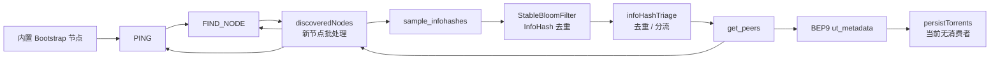

# bing-dhtcrawler

简体中文 | [English](README_EN.md)

基于 Go 的 BitTorrent DHT 爬虫 / DHT 服务端。它通过 DHT 网络持续发现节点、InfoHash 与 Peer，并可进一步通过 BEP9 `ut_metadata` 拉取种子元数据。

项目可作为独立进程运行，也可作为 Go module 被 `bing-play` 等业务项目引入。

> 当前版本：`v0.2.0`（见 [version.go](version.go)）
> 模块路径：`github.com/bing/bing-dhtcrawler`
> Go 版本要求：`go 1.26.0`（见 [go.mod](go.mod)）

---

## 1. 特性与实现状态

| 能力 | 协议 | 状态 |
| --- | --- | --- |
| Ping 节点、校正 NodeID、维护活跃时间 | BEP5 | 已实现 |
| FindNode 节点发现 | BEP5 | 已实现 |
| get_peers 获取 Peer / 邻近节点 | BEP5 | 已实现 |
| sample_infohashes 批量采样 InfoHash | BEP51 | 已实现 |
| scrape（获取 Seeder/Leecher 估算） | BEP33 | 底层能力已实现，流水线默认关闭 |
| ut_metadata 拉取种子元数据 | BEP9 | 已实现 |
| Bootstrap 节点定时重连 | BEP5 | 已实现 |
| InfoHash Bloom Filter 去重 | — | 已实现 |
| 全局节点 / InfoHash / Peer 注册表 | — | 已实现 |
| Kademlia Routing Table | BEP5 | 由 `anacrolix/dht` 内部维护 |
| 元数据 / Source 持久化 | — | **未启用**（消费协程被注释） |
| Storage 默认实现 | — | **空实现**（no-op） |
| Triage / Blocking 策略 | — | **仅接口，未接入** |
| 单元测试 | — | **暂无** |

---

## 2. 整体架构

项目按职责拆分为以下包：

```text
cmd/bing-dhtcrawler/   独立进程入口：创建 DHT Client、Requester、Metrics、Storage 并启动爬虫
crawler/               爬虫引擎：协程编排、节点/InfoHash 处理流水线、内存注册表
  metrics/             基于 Prometheus 的自定义指标封装
dht/                   DHT 抽象层与 anacrolix/dht 适配实现，BEP33 Bloom 估算
metadata/              BEP9 ut_metadata 客户端（TCP + 扩展协议）
storage/               Storage 接口与空实现 DefaultStorage
concurrency/           批处理通道、并发通道、泛型原子值等并发原语
blocking/              屏蔽规则接口（未接入）
docs/                  bing-play 集成说明
```

### 2.1 分层关系

- **DHT 层**：`dht.Client` 接口抽象 Ping / FindNode / GetPeers / SampleInfoHashes 等操作，默认实现为 [anacrolix.go](dht/anacrolix.go)，底层使用 `github.com/anacrolix/dht/v2`。
- **爬虫引擎**：`crawler.BingCrawler` 只依赖 `dht.Client`、`metadata.Requester`、`storage.Storage` 等接口，便于替换实现。
- **内存注册表**：[bing_data.go](crawler/bing_data.go) 中的 `BingData` 维护全局节点与 InfoHash 关系，独立于 Kademlia 路由表。
- **元数据层**：[requester.go](metadata/requester.go) 通过 BitTorrent 握手与 LTEP 扩展协议读取 `ut_metadata` 分片。
- **持久化层**：`storage.Storage` 定义保存与查询接口，当前默认实现不写入任何数据。

### 2.2 与 Kademlia Routing Table 的关系

`anacrolix/dht` 内部维护自己的路由表（K-Bucket），用于节点查询和网络维护；本项目的 `BingData` 是**爬虫视角的全局注册表**，记录“谁曾经响应过、哪些 InfoHash 与哪些 Peer 关联”。

两者职责分离：

1. Kademlia Routing View：由 DHT 库负责，随节点进出自动淘汰。
2. Global Node Registry：由 `BingData` 负责，记录爬虫发现过的节点及其活跃时间。
3. Global Hash Registry：由 `BingData` 维护 `InfoHash -> []Peer` 与 `Peer -> []InfoHash` 的双向关系。

---

## 3. 数据流



核心处理链路：

1. **Bootstrap**：启动时立即把内置的 3 个公共路由节点放入 Ping 队列，之后每 30 分钟重新投递一次。
2. **Ping**：成功则更新 NodeID 与最后响应时间；失败则从 `BingData` 移除节点。
3. **FindNode**：以每 10 秒轮换一次的随机目标 ID 查询，返回的节点进入 `discoveredNodes`。
4. **节点去重**：`BingData.HasNode` 过滤已知节点，再按同一批次内的 IP 去重，随后分发到 Ping / FindNode / SampleInfoHashes 三个队列。
5. **BEP51 采样**：对满足条件的节点调用 `sample_infohashes`，返回的 InfoHash 经 Bloom Filter 去重后进入 Triage。
6. **Triage**：按 InfoHash 去重并投递 `get_peers`；同时查询 `Storage.GetTriageInfo` 判断是否已有元数据（默认实现返回空）。
7. **get_peers**：获取 Peer 列表与邻近节点；邻近节点回到节点发现队列，Peer 列表交给 BEP9。
8. **BEP9**：对每个 Peer 尝试 TCP 连接，完成握手与扩展握手后分片请求元数据，校验 SHA1 后解析为 `metainfo.Info`。
9. **持久化**：元数据进入 `persistTorrents` 批处理队列；但负责消费该队列的 `runPersistTorrents` 当前被注释，`runPersistSources` 同样被注释，因此数据不会落盘。

---

## 4. 目录与关键代码

| 文件 | 说明 |
| --- | --- |
| [cmd/bing-dhtcrawler/main.go](cmd/bing-dhtcrawler/main.go) | 独立进程入口，监听固定 UDP 端口 `51413` |
| [crawler/crawler.go](crawler/crawler.go) | `BingCrawler` 结构体、队列定义、`Start` 协程编排、`IgnoreHashes` |
| [crawler/crawler_handler.go](crawler/crawler_handler.go) | 各流水线协程的具体实现 |
| [crawler/bing_data.go](crawler/bing_data.go) | 全局节点 / InfoHash / Peer 注册表 |
| [crawler/triage.go](crawler/triage.go) | Triage 接口与结果结构（未接入） |
| [crawler/metrics/](crawler/metrics/) | 指标创建、读写与打印 |
| [dht/client.go](dht/client.go) | `Client` 接口、NodeID / InfoHash 类型、结果结构 |
| [dht/node.go](dht/node.go) | 节点状态：最后响应时间、BEP51 支持标记、下次采样时间 |
| [dht/anacrolix.go](dht/anacrolix.go) | `anacrolix/dht` 适配实现 |
| [dht/scrape.go](dht/scrape.go) | BEP33 Scrape Bloom Filter 与数量估算 |
| [metadata/requester.go](metadata/requester.go) | BEP9 元数据请求器 |
| [storage/storage.go](storage/storage.go) | `Storage` 接口、`TriageInfo`、空实现 |
| [concurrency/](concurrency/) | 并发原语 |
| [docs/bing-play-integration.md](docs/bing-play-integration.md) | 业务集成说明 |

---

## 5. 核心组件详解

### 5.1 BingCrawler

`BingCrawler` 是引擎主体（[crawler.go](crawler/crawler.go)），持有：

- `dht.Client`、`metadata.Requester`、`storage.Storage`、`metrics.Metrics`
- `BingData` 全局注册表
- `IgnoreHashes` InfoHash 去重器
- 11 个处理队列
- 定时参数、Bootstrap 节点列表、`slog.Logger`

`Start(ctx)` 使用 `sync.Once` 保证只执行一次，启动以下协程：

| 协程 | 职责 |
| --- | --- |
| `generateSoughtNodeID` | 每 10 秒生成新的随机 FindNode / Sample 目标 ID |
| `runDiscoveredNodes` | 过滤、按 IP 去重并分发新节点 |
| `runPing` | 执行 Ping，维护 NodeID 与活跃时间 |
| `runFindNode` / `runNodesForFindNode` | 执行 FindNode；周期性挑选最久未活跃的节点 |
| `runSampleInfoHashes` / `runNodesForSampleInfoHashes` | 执行 BEP51 采样；周期性挑选可采样节点 |
| `runInfoHashTriage` | InfoHash 去重、查库、投递 get_peers |
| `runGetHashInfoPeers` | 执行 get_peers，投递 Peer 列表 |
| `runRequestMetaInfo` | 对每个 Peer 请求 BEP9 元数据 |
| `runScrape` | 执行 BEP33 scrape（当前未被 `Start` 启动） |
| `reseedBootstrapNodes` | 定时重新投递 Bootstrap 节点 |
| `runMerics` | 启动时打印一次指标，之后每 2 分钟打印一次 |

爬虫没有 `Close` / `Stop` 方法，生命周期由传入的 `context.Context` 控制：取消 ctx 即退出所有循环。

### 5.2 BingData 全局注册表

[bing_data.go](crawler/bing_data.go) 维护两个 map：

```go
// InfoHash -> Peers
PeersMapByInfoHash map[dht.InfoHash][]*dht.Node
// Peer -> InfoHashes
InfoHashMapByNode  map[*dht.Node][]dht.InfoHash
```

要点：

- `PutNode`：首次见到节点时写入 `InfoHashMapByNode[node] = nil`，并累加 `NodesTotal` 指标。
- `PutHash`：按 IP 去重后追加 Peer，并维护 Peer 到 InfoHash 的反向关系。
- `RemoveNode`：按地址清理该节点关联的所有 InfoHash 关系。
- `GetOldestNodes`：按最后响应时间挑选最久未活跃的节点。
- `GetNodesForSampleInfoHashes`：挑选已到采样时间且支持 BEP51 的节点。

注意：map 使用 `*dht.Node` 指针作为 key，语义上依赖对象指针身份；同一地址的不同 Node 实例不会被视为同一个 key。

### 5.3 并发原语与队列参数

[concurrency/](concurrency/) 提供三种工具：

- `BatchingChannel[T]`：按批大小或等待时间聚合。输出通道容量为 1，**必须有消费者**，否则批次 flush 会阻塞。
- `BufferedConcurrentChannel[T]`：带缓冲输入，固定数量 worker 并发消费。文档约定发送方完成后应关闭 `In()`，或取消 ctx。
- `AtomicValue[T]`：泛型读写锁封装。

`BingCrawler` 内的队列配置（定义于 [crawler.go](crawler/crawler.go)）：

| 队列 | 类型 | 容量 | 并发 / 批大小 | 等待时间 |
| --- | --- | --- | --- | --- |
| `discoveredNodes` | Batching | 1000 | 80 | 10ms |
| `nodesForPing` | Concurrent | 1000 | 32 workers | — |
| `nodesForFindNode` | Concurrent | 1000 | 32 workers | — |
| `nodesForSampleInfoHashes` | Concurrent | 1000 | 32 workers | — |
| `infoHashTriage` | Batching | 1000 | 100 | 10ms |
| `getPeers` | Concurrent | 1000 | 32 workers | — |
| `scrape` | Concurrent | 1000 | 32 workers | — |
| `requestMetaInfo` | Concurrent | 1000 | 16 workers | — |
| `persistTorrents` | Batching | 1000 | 100 | 10ms |
| `persistSources` | Batching | 1000 | 100 | 10ms |

### 5.4 DHT 抽象与适配

[dht/client.go](dht/client.go) 定义：

```go
type Client interface {
    Bootstrap(ctx context.Context) error
    Ping(node *Node) (NodeID, error)
    FindNode(node *Node, target NodeID) ([]Node, error)
    GetPeers(ctx context.Context, node *Node, infoHash InfoHash, scrape bool) (GetPeersResult, error)
    SampleInfoHashes(ctx context.Context, node *Node, target NodeID) (SampleInfoHashesResult, error)
    Nodes() []Node
    AddNode(node *Node) error
    RemoveNode(node *Node)
    Close()
}
```

[anacrolix.go](dht/anacrolix.go) 将上述方法映射到 `anacrolix/dht/v2`：

- `Ping` / `FindNode`：同步查询并转换返回节点。
- `GetPeers`：`scrape=true` 时返回 BEP33 Bloom Filter。
- `SampleInfoHashes`：通过通用 `Query` 发送 `sample_infohashes`；错误码 `204` 映射为 `ErrMethodUnknown`，用于标记节点不支持 BEP51。
- `RemoveNode`：底层库没有公开删除 API，因此是空操作。
- NodeID 后缀工具 `RandomNodeIDWithClientSuffix()` 会在 ID 末尾写入 `-Bing`，便于识别同类实例（当前主程序未使用）。

### 5.5 节点状态机

[dht/node.go](dht/node.go) 中的 `Node` 记录：

- `ID`：20 字节 NodeID
- `Addr`：`netip.AddrPort`
- `lastRespondedAt`：最后成功响应时间
- `bep51`：`0` 未知 / `1` 支持 / `2` 不支持
- `nextSampleTime`：下一次允许采样的时间

采样条件：`bep51 != 2` 且 `nextSampleTime` 早于当前时间 5 秒以上。服务端返回的 `interval` 会写入 `nextSampleTime`，用于自适应采样频率。

### 5.6 InfoHash 去重

`IgnoreHashes` 使用 `tylertreat/BoomFilters` 的 `StableBloomFilter`，默认容量 1,000,000、误判率 1%（见 [main.go](cmd/bing-dhtcrawler/main.go)）。通过互斥锁包装 `TestAndAdd`，保证并发安全。

该过滤器**仅存在于内存**，进程重启后丢失，重启初期会重新处理一批历史 InfoHash。

### 5.7 Triage 分流

`runInfoHashTriage` 的处理顺序：

1. 按 InfoHash 去重，得到唯一列表。
2. 对每个唯一 InfoHash 投递 `getPeers`。
3. 调用 `Storage.GetTriageInfo` 批量查询已有数据。
4. 若记录不存在或没有元数据，再次投递 `getPeers`（真实 Storage 实现下可能出现重复投递）。
5. 原设计还有 scrape 重抓判断，当前被注释。

[triage.go](crawler/triage.go) 定义的 `Triage` 接口尚未接入引擎。

### 5.8 BEP9 元数据请求

[requester.go](metadata/requester.go) 的请求流程：

1. 以 `tcp4` 连接 Peer，设置 `SetLinger(0)` 与截止时间。
2. BitTorrent 握手：协议头 + 扩展位 + InfoHash + ClientID，并校验返回的 InfoHash。
3. 校验对方支持 LTEP（扩展位 20）。
4. 发送扩展握手，读取 `metadata_size` 与 `ut_metadata` 扩展号。
5. 按 16 KiB 分片请求元数据，最多 10 MiB。
6. 拼接分片后校验 SHA1 必须等于 InfoHash，再 bencode 解析为 `metainfo.Info`。

`NodeID` 用于握手 ClientID，超时默认 10 秒。

### 5.9 BEP33 Scrape

`dht.GetPeers(..., scrape=true)` 会返回 `BfSeeders` / `BfPeers`，类型为 `krpc.ScrapeBloomFilter`。[scrape.go](dht/scrape.go) 提供了：

- 向 Bloom Filter 添加 IP
- 统计零位数量并估算元素数量（`EstimateCount`，k=2）
- 转换为 `bits-and-blooms/bloom` 过滤器

`runScrape` 与 `persistSources` 已实现但未启用。

### 5.10 Storage

[storage.go](storage/storage.go)：

```go
type Storage interface {
    SaveTorrents(ctx context.Context, items []any) error
    SaveSources(ctx context.Context, items []any) error
    GetTriageInfo(ctx context.Context, hashes []dht.InfoHash) (map[dht.InfoHash]TriageInfo, error)
}
```

`TriageInfo` 包含：是否存在、是否有元数据、Seeder / Leecher 数量、最后更新时间。

`DefaultStorage` 的 `SaveTorrents` / `SaveSources` 直接返回 nil，`GetTriageInfo` 返回 `nil, nil`。接入 `bing-play` 时应实现该接口。

注意：`SaveTorrents` / `SaveSources` 的入参为 `[]any`，调用方已被注释，目前没有实际类型约束。

### 5.11 Metrics

[crawler/metrics/](crawler/metrics/) 基于 `prometheus/client_golang` 自建注册表，支持 Counter、Gauge、Histogram，并提供 `Inc/Add/Dec/Sub/Set/Observe` 与 `Print()`。

已注册指标：

| 指标名 | 类型 | 含义 | 当前是否上报 |
| --- | --- | --- | --- |
| `bing_dhtcrawler_nodes_total` | Gauge | 当前已知节点数 | 是（`PutNode`） |
| `bing_dhtcrawler_nodes_discovered_total` | Counter | 累计发现节点数 | 否 |
| `bing_dhtcrawler_nodes_removed_total` | Counter | 累计移除节点数 | 否 |
| `bing_dhtcrawler_infohashes_total` | Gauge | 当前已知 InfoHash 数 | 否 |
| `bing_dhtcrawler_infohashes_discovered_total` | Counter | 累计获取 InfoHash 数 | 否 |
| `bing_dhtcrawler_infohashes_new_total` | Counter | 累计新 InfoHash 数 | 否 |

目前没有 HTTP 暴露端点，指标通过 `Print()` 每 2 分钟输出到标准输出。可直接使用 `Metrics.Registry()` 接入自定义 exporter。

---

## 6. 快速开始

### 6.1 环境要求

- Go `1.26.0` 或更高版本
- 可访问 UDP 出网（DHT）与 TCP 出网（BEP9）
- 本机 UDP `51413` 端口可用（当前写死在 [main.go](cmd/bing-dhtcrawler/main.go)）

### 6.2 构建与运行

```bash
go build ./...

# 启动独立爬虫
go run ./cmd/bing-dhtcrawler
```

启动后日志示例：

```text
time=... level=INFO msg="bing-dhtcrawler started"
```

使用 `Ctrl+C` 停止。程序监听 `SIGINT` / `SIGTERM`，取消上下文后退出。

### 6.3 验证命令

```bash
go build ./...        # 通过
go vet ./...          # 当前有两处 slog 参数告警
go test ./...         # 仓库暂无测试文件
go test -race ./...   # 仓库暂无测试文件
```

当前仓库**没有单元测试**；`go test ./...` 会因 `go vet` 检查失败而报告构建错误，位置在 [crawler_handler.go](crawler/crawler_handler.go) 的两处 `slog.Logger.Error` 调用（第二个参数不是字符串或 `slog.Attr`）。

---

## 7. 作为 Go module 集成

### 7.1 引入方式

正式发布后：

```bash
go get github.com/bing/bing-dhtcrawler@v0.2.0
```

本地开发：

```go
require github.com/bing/bing-dhtcrawler v0.2.0

replace github.com/bing/bing-dhtcrawler => ../bing-dhtcrawler
```

### 7.2 最小接入示例

项目没有 `Config` 类型，所有参数通过构造函数与常量提供。最小接入方式与 [main.go](cmd/bing-dhtcrawler/main.go) 一致：

```go
package main

import (
	"context"
	"log/slog"
	"os/signal"
	"syscall"
	"time"

	"github.com/bing/bing-dhtcrawler/crawler"
	metrics2 "github.com/bing/bing-dhtcrawler/crawler/metrics"
	"github.com/bing/bing-dhtcrawler/dht"
	"github.com/bing/bing-dhtcrawler/metadata"
	"github.com/bing/bing-dhtcrawler/storage"
	boom "github.com/tylertreat/BoomFilters"
)

func main() {
	ctx, stop := signal.NotifyContext(context.Background(), syscall.SIGINT, syscall.SIGTERM)
	defer stop()

	client, err := dht.NewAnacrolixClient(nil)
	if err != nil {
		panic(err)
	}
	defer client.Close()

	metrics, err := metrics2.InitMetrics()
	if err != nil {
		panic(err)
	}

	c := crawler.NewBingCrawler(
		client,
		metrics,
		crawler.NewBingData(),
		metadata.NewRequester(dht.RandomNodeID(), 10*time.Second),
		storage.NewDefaultStorage(), // 替换为业务侧实现
		crawler.NewIgnoreHashes(boom.NewDefaultStableBloomFilter(1_000_000, 0.01)),
		slog.Default(),
	)
	c.Start(ctx)

	<-ctx.Done()
}
```

### 7.3 业务侧可用的公开入口

- `crawler.NewBingCrawler(...)`：创建引擎
- `crawler.BingCrawler.Start(ctx)`：启动所有流水线
- `crawler.NewBingData()`：内存注册表
- `crawler.NewIgnoreHashes(filter)`：InfoHash 去重器
- `dht.NewAnacrolixClient(config)`：默认 DHT 客户端
- `metadata.NewRequester(clientID, timeout)`：BEP9 请求器
- `storage.Storage` / `storage.DefaultStorage`：持久化接口
- `metrics.InitMetrics()` / `metrics.Metrics`：指标

典型业务数据流：

```text
DHT -> InfoHash -> get_peers -> BEP9 Metadata -> Storage -> bing-play ResourceService / SQLite
```

更完整的说明见 [docs/bing-play-integration.md](docs/bing-play-integration.md)。

---

## 8. 参数与调优

由于没有独立的配置结构，以下参数需要直接修改构造代码：

| 参数 | 默认值 | 位置 | 说明 |
| --- | --- | --- | --- |
| Bootstrap 节点 | `router.bittorrent.com:6881` 等 3 个 | [crawler.go](crawler/crawler.go#L101-L105) | 启动即投递，之后定时重投 |
| Bootstrap 重投间隔 | 30 分钟 | [crawler.go](crawler/crawler.go#L107) | `reseedBootstrapNodesInterval` |
| 目标 ID 轮换间隔 | 10 秒 | [crawler.go](crawler/crawler.go#L246) | `soughtNodeID` |
| 旧节点阈值 | 5 秒 | [crawler.go](crawler/crawler.go#L109) | Ping 跳过刚活跃的节点 |
| 旧节点挑选周期 | 5 秒 / 10 个 | [crawler_handler.go](crawler/crawler_handler.go#L87-L90) | `runNodesForFindNode` |
| 采样节点挑选周期 | 5 秒 / 60 个 | [crawler_handler.go](crawler/crawler_handler.go#L152-L155) | `runNodesForSampleInfoHashes` |
| 采样冷却 | 5 秒 | [node.go](dht/node.go#L42-L48) | `IsSampleInfoHashesCheck` |
| 元数据超时 | 10 秒 | [main.go](cmd/bing-dhtcrawler/main.go#L38-L41) | `metadata.NewRequester` |
| 元数据最大体积 | 10 MiB | [requester.go](metadata/requester.go#L244) | `maxMetadataSize` |
| Bloom 容量 / 误判率 | 1,000,000 / 1% | [main.go](cmd/bing-dhtcrawler/main.go#L48) | 重启后重置 |
| DHT 监听端口 | UDP `51413` | [main.go](cmd/bing-dhtcrawler/main.go#L80-L84) | 写死，未配置化 |
| 指标打印间隔 | 2 分钟 | [crawler.go](crawler/crawler.go#L252-L263) | `runMerics` |

`getOldestNodesInterval`、`rescrapeThreshold`、`saveFilesThreshold`、`savePieces` 等字段仍保留在结构体中，但相关逻辑当前未生效。

---

## 9. 当前限制与后续计划

当前实现是一个**可运行的发现 + 元数据抓取内核**，但持久化闭环尚未接上：

1. **持久化未启用**：`Start` 中没有启动 `runPersistTorrents` / `runPersistSources`，`persistTorrents` / `persistSources` 队列没有消费者。批处理通道输出容量为 1，队列填满后生产者最终会阻塞，元数据链路会随之停滞。
2. **Storage 为空实现**：`DefaultStorage` 不保存任何内容，`GetTriageInfo` 返回空，接入业务侧需要自行实现。
3. **Triage / Blocking 未接入**：`crawler.Triage` 与 `blocking.Manager` 只有接口定义。
4. **BEP33 未启用**：`runScrape` 与 scrape 重抓判断被注释。
5. **无配置结构**：端口、Bootstrap、并发度、Bloom 参数等均写死在代码中。
6. **指标不完整**：仅 `nodes_total` 实际上报，其余已注册指标尚未埋点。
7. **无 HTTP 指标端点**：需要业务侧自行挂载 Prometheus exporter。
8. **无单元测试**：`go test ./...` 目前没有测试可运行，且 `go vet` 有两处告警。
9. **重启状态丢失**：节点、InfoHash、Bloom 状态均在内存中，未做持久化恢复。
10. **采样来源受限**：`GetNodesForSampleInfoHashes` 从 `PeersMapByInfoHash` 遍历节点，尚未与 InfoHash 建立关系的节点不会进入采样队列。

建议的后续工作顺序：

- 实现 `Storage` 并重新启用持久化协程
- 补齐 `nodes_discovered_total` 等指标埋点
- 将硬编码参数收敛为可注入的配置
- 增加 DHT 客户端、BEP9、并发通道的单元测试
- 接入 Triage / Blocking 策略与 scrape 重抓

---

## 10. 合规与安全

DHT 爬虫会主动连接公网节点并抓取公开的种子元数据。请仅在合法合规的前提下用于自有系统、学术研究或安全分析，并遵守所在地法律法规与网络使用条款。项目中不要在日志或代码中写入任何密钥、令牌或私有凭据。

---

## 11. 相关文档

- [bing-play 集成说明](docs/bing-play-integration.md)
- [项目开发规范](AGENTS.md)

本仓库尚未包含 `LICENSE` 文件。
