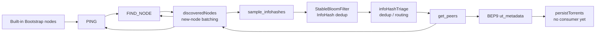

# bing-dhtcrawler

[简体中文](README.md) | English

A BitTorrent DHT crawler / DHT server written in Go. It continuously discovers DHT nodes, InfoHashes, and peers, and can optionally fetch torrent metadata through BEP9 `ut_metadata`.

It can run as a standalone process or be imported as a Go module by projects such as `bing-play`.

> Current version: `v0.2.0` (see [version.go](version.go))
> Module path: `github.com/DMzmwh/bing-dhtcrawler`
> Go version: `go 1.26.0` (see [go.mod](go.mod))

---

## 1. Features and Implementation Status

| Capability | Protocol | Status |
| --- | --- | --- |
| Ping nodes, correct NodeID, track last response time | BEP5 | Implemented |
| FindNode node discovery | BEP5 | Implemented |
| get_peers for peers / neighboring nodes | BEP5 | Implemented |
| sample_infohashes bulk InfoHash sampling | BEP51 | Implemented |
| scrape (Seeder/Leecher estimates) | BEP33 | Low-level support implemented, pipeline disabled |
| ut_metadata torrent metadata retrieval | BEP9 | Implemented |
| Periodic Bootstrap node reseeding | BEP5 | Implemented |
| InfoHash deduplication with Bloom Filter | — | Implemented |
| Global node / InfoHash / peer registry | — | Implemented |
| Kademlia Routing Table | BEP5 | Maintained internally by `anacrolix/dht` |
| Metadata / source persistence | — | **Not enabled** (consumer goroutines commented out) |
| Default Storage implementation | — | **No-op** |
| Triage / Blocking policies | — | **Interfaces only, not wired in** |
| Unit tests | — | **None** |

---

## 2. Architecture

The project is split into the following packages:

```text
cmd/bing-dhtcrawler/   Standalone entry point: creates the DHT client, requester, metrics,
                       storage, and starts the crawler
crawler/               Crawler engine: goroutine orchestration, node/InfoHash pipelines,
                       in-memory registry
  metrics/             Custom Prometheus metrics wrapper
dht/                   DHT abstraction layer, anacrolix/dht adapter, BEP33 Bloom estimation
metadata/              BEP9 ut_metadata client (TCP + extension protocol)
storage/               Storage interface and no-op DefaultStorage
concurrency/           Batching channels, concurrent channels, generic atomic value
blocking/              Blocking policy interface (not wired in)
docs/                  bing-play integration notes
```

### 2.1 Layer responsibilities

- **DHT layer**: the `dht.Client` interface abstracts Ping / FindNode / GetPeers / SampleInfoHashes. The default implementation is [anacrolix.go](dht/anacrolix.go), backed by `github.com/anacrolix/dht/v2`.
- **Crawler engine**: `crawler.BingCrawler` depends only on interfaces such as `dht.Client`, `metadata.Requester`, and `storage.Storage`, making implementations replaceable.
- **In-memory registry**: `BingData` in [bing_data.go](crawler/bing_data.go) maintains global node and InfoHash relationships, independent of the Kademlia routing table.
- **Metadata layer**: [requester.go](metadata/requester.go) reads `ut_metadata` pieces through the BitTorrent handshake and the LTEP extension protocol.
- **Persistence layer**: `storage.Storage` defines save and query methods; the current default implementation writes nothing.

### 2.2 Relationship to the Kademlia routing table

`anacrolix/dht` maintains its own routing table (K-Buckets) for node lookups and network maintenance. `BingData` in this project is a **crawler-level global registry**: it records who has responded and which InfoHashes are associated with which peers.

The responsibilities are deliberately separated:

1. Kademlia routing view: managed by the DHT library, with nodes evicted automatically as they come and go.
2. Global node registry: managed by `BingData`, recording every node the crawler has seen and when it was last active.
3. Global hash registry: managed by `BingData`, maintaining a bidirectional `InfoHash -> []Peer` and `Peer -> []InfoHash` relationship.

---

## 3. Data Flow



Core pipeline:

1. **Bootstrap**: the three built-in public router nodes are pushed into the Ping queue immediately at startup, then re-pushed every 30 minutes.
2. **Ping**: on success, update the NodeID and last response time; on failure, remove the node from `BingData`.
3. **FindNode**: query with a random target ID that rotates every 10 seconds; returned nodes go into `discoveredNodes`.
4. **Node deduplication**: `BingData.HasNode` filters known nodes, then IPs are deduplicated within the same batch; the result is fanned out to the Ping / FindNode / SampleInfoHashes queues.
5. **BEP51 sampling**: eligible nodes are queried with `sample_infohashes`; returned InfoHashes are deduplicated by the Bloom Filter and passed to Triage.
6. **Triage**: InfoHashes are deduplicated and submitted to `get_peers`; `Storage.GetTriageInfo` is also queried to check whether metadata already exists (the default implementation returns nothing).
7. **get_peers**: retrieves the peer list and neighboring nodes; neighboring nodes go back to the discovery queue, and peers are handed to BEP9.
8. **BEP9**: for each peer, open a TCP connection, complete the handshake and extension handshake, request metadata in pieces, verify the SHA1 hash, and parse the result into `metainfo.Info`.
9. **Persistence**: metadata enters the `persistTorrents` batching queue; however, `runPersistTorrents`, which consumes that queue, is currently commented out, as is `runPersistSources`. Nothing is written to disk.

---

## 4. Directory and Key Files

| File | Description |
| --- | --- |
| [cmd/bing-dhtcrawler/main.go](cmd/bing-dhtcrawler/main.go) | Standalone entry point, listens on the hard-coded UDP port `51413` |
| [crawler/crawler.go](crawler/crawler.go) | `BingCrawler` struct, queue definitions, `Start` orchestration, `IgnoreHashes` |
| [crawler/crawler_handler.go](crawler/crawler_handler.go) | Implementations of the pipeline goroutines |
| [crawler/bing_data.go](crawler/bing_data.go) | Global node / InfoHash / peer registry |
| [crawler/triage.go](crawler/triage.go) | Triage interface and result struct (not wired in) |
| [crawler/metrics/](crawler/metrics/) | Metric creation, access, and printing |
| [dht/client.go](dht/client.go) | `Client` interface, NodeID / InfoHash types, result structs |
| [dht/node.go](dht/node.go) | Node state: last response time, BEP51 support flag, next sample time |
| [dht/anacrolix.go](dht/anacrolix.go) | `anacrolix/dht` adapter |
| [dht/scrape.go](dht/scrape.go) | BEP33 scrape Bloom Filter and count estimation |
| [metadata/requester.go](metadata/requester.go) | BEP9 metadata requester |
| [storage/storage.go](storage/storage.go) | `Storage` interface, `TriageInfo`, no-op implementation |
| [concurrency/](concurrency/) | Concurrency primitives |
| [docs/bing-play-integration.md](docs/bing-play-integration.md) | Integration notes |

---

## 5. Core Components in Detail

### 5.1 BingCrawler

`BingCrawler` is the engine core ([crawler.go](crawler/crawler.go)). It holds:

- `dht.Client`, `metadata.Requester`, `storage.Storage`, `metrics.Metrics`
- the `BingData` global registry
- the `IgnoreHashes` InfoHash deduplicator
- 11 processing queues
- timing parameters, the Bootstrap node list, and a `slog.Logger`

`Start(ctx)` uses `sync.Once` to run only once and launches the following goroutines:

| Goroutine | Responsibility |
| --- | --- |
| `generateSoughtNodeID` | Generates a new random FindNode / Sample target ID every 10 seconds |
| `runDiscoveredNodes` | Filters, deduplicates by IP, and fans out new nodes |
| `runPing` | Pings nodes and maintains NodeID and activity time |
| `runFindNode` / `runNodesForFindNode` | Executes FindNode; periodically selects the least recently active nodes |
| `runSampleInfoHashes` / `runNodesForSampleInfoHashes` | Executes BEP51 sampling; periodically selects eligible nodes |
| `runInfoHashTriage` | Deduplicates InfoHashes, queries storage, submits get_peers |
| `runGetHashInfoPeers` | Executes get_peers and submits peer lists |
| `runRequestMetaInfo` | Requests BEP9 metadata from each peer |
| `runScrape` | Executes BEP33 scrape (not started by `Start` currently) |
| `reseedBootstrapNodes` | Periodically re-submits Bootstrap nodes |
| `runMerics` | Prints metrics once at startup, then every 2 minutes |

The crawler has no `Close` / `Stop` method. Its lifecycle is controlled by the passed-in `context.Context`: canceling the context exits every loop.

### 5.2 BingData global registry

[bing_data.go](crawler/bing_data.go) maintains two maps:

```go
// InfoHash -> Peers
PeersMapByInfoHash map[dht.InfoHash][]*dht.Node
// Peer -> InfoHashes
InfoHashMapByNode  map[*dht.Node][]dht.InfoHash
```

Key points:

- `PutNode`: on first sight of a node, inserts `InfoHashMapByNode[node] = nil` and increments the `NodesTotal` metric.
- `PutHash`: appends peers after deduplicating by IP and maintains the reverse peer-to-InfoHash relationship.
- `RemoveNode`: cleans up every InfoHash relationship associated with the node by address.
- `GetOldestNodes`: selects the least recently active nodes by last response time.
- `GetNodesForSampleInfoHashes`: selects nodes that are due for sampling and support BEP51.

Note: the maps use `*dht.Node` pointers as keys, so identity is based on the object pointer. Two `Node` instances for the same address are not treated as the same key.

### 5.3 Concurrency primitives and queue parameters

[concurrency/](concurrency/) provides three tools:

- `BatchingChannel[T]`: aggregates by batch size or waiting time. The output channel has a capacity of 1, so **a consumer is mandatory**; otherwise flushing a batch blocks.
- `BufferedConcurrentChannel[T]`: buffered input consumed concurrently by a fixed number of workers. The documented contract is that the sender must close `In()` when done, or cancel the context.
- `AtomicValue[T]`: a generic read-write-lock wrapper.

Queue configuration inside `BingCrawler` (defined in [crawler.go](crawler/crawler.go)):

| Queue | Type | Capacity | Concurrency / batch size | Wait time |
| --- | --- | --- | --- | --- |
| `discoveredNodes` | Batching | 1000 | 80 | 10ms |
| `nodesForPing` | Concurrent | 1000 | 32 workers | — |
| `nodesForFindNode` | Concurrent | 1000 | 32 workers | — |
| `nodesForSampleInfoHashes` | Concurrent | 1000 | 32 workers | — |
| `infoHashTriage` | Batching | 1000 | 100 | 10ms |
| `getPeers` | Concurrent | 1000 | 32 workers | — |
| `scrape` | Concurrent | 1000 | 32 workers | — |
| `requestMetaInfo` | Concurrent | 1000 | 16 workers | — |
| `persistTorrents` | Batching | 1000 | 100 | 10ms |
| `persistSources` | Batching | 1000 | 100 | 10ms |

### 5.4 DHT abstraction and adapter

[dht/client.go](dht/client.go) defines:

```go
type Client interface {
    Bootstrap(ctx context.Context) error
    Ping(node *Node) (NodeID, error)
    FindNode(node *Node, target NodeID) ([]Node, error)
    GetPeers(ctx context.Context, node *Node, infoHash InfoHash, scrape bool) (GetPeersResult, error)
    SampleInfoHashes(ctx context.Context, node *Node, target NodeID) (SampleInfoHashesResult, error)
    Nodes() []Node
    AddNode(node *Node) error
    RemoveNode(node *Node)
    Close()
}
```

[anacrolix.go](dht/anacrolix.go) maps these methods onto `anacrolix/dht/v2`:

- `Ping` / `FindNode`: synchronous queries with node conversion.
- `GetPeers`: returns BEP33 Bloom Filters when `scrape=true`.
- `SampleInfoHashes`: sends `sample_infohashes` through the generic `Query` API; error code `204` is mapped to `ErrMethodUnknown` to mark nodes that do not support BEP51.
- `RemoveNode`: a no-op because the underlying library exposes no public removal API.
- The NodeID suffix helper `RandomNodeIDWithClientSuffix()` appends `-Bing` to the ID to identify sibling instances (not used by the main program currently).

### 5.5 Node state machine

`Node` in [dht/node.go](dht/node.go) records:

- `ID`: 20-byte NodeID
- `Addr`: `netip.AddrPort`
- `lastRespondedAt`: last successful response time
- `bep51`: `0` unknown / `1` supported / `2` unsupported
- `nextSampleTime`: next allowed sampling time

Sampling condition: `bep51 != 2` and `nextSampleTime` is more than 5 seconds in the past. The `interval` returned by the server is written to `nextSampleTime` for adaptive sampling frequency.

### 5.6 InfoHash deduplication

`IgnoreHashes` uses `tylertreat/BoomFilters`' `StableBloomFilter` with a default capacity of 1,000,000 and a 1% false-positive rate (see [main.go](cmd/bing-dhtcrawler/main.go)). `TestAndAdd` is wrapped in a mutex for concurrency safety.

The filter exists **in memory only** and is lost on restart, so a batch of historical InfoHashes will be reprocessed shortly after a restart.

### 5.7 Triage routing

`runInfoHashTriage` processes as follows:

1. Deduplicate InfoHashes into a unique list.
2. Submit `getPeers` for every unique InfoHash.
3. Call `Storage.GetTriageInfo` to query existing data in bulk.
4. If a record does not exist or has no metadata, submit `getPeers` again (with a real Storage implementation this may cause duplicate submissions).
5. The original design also had a scrape re-fetch decision, which is currently commented out.

The `Triage` interface defined in [triage.go](crawler/triage.go) is not wired into the engine yet.

### 5.8 BEP9 metadata requests

Request flow in [requester.go](metadata/requester.go):

1. Connect to the peer over `tcp4`, set `SetLinger(0)`, and set a deadline.
2. BitTorrent handshake: protocol header + extension bits + InfoHash + ClientID, and verify the returned InfoHash.
3. Verify that the peer supports LTEP (extension bit 20).
4. Send the extension handshake and read `metadata_size` and the `ut_metadata` extension ID.
5. Request metadata in 16 KiB pieces, up to 10 MiB.
6. After assembling the pieces, verify that the SHA1 equals the InfoHash, then bencode-decode into `metainfo.Info`.

The `NodeID` is used as the handshake ClientID, and the default timeout is 10 seconds.

### 5.9 BEP33 Scrape

`dht.GetPeers(..., scrape=true)` returns `BfSeeders` / `BfPeers` of type `krpc.ScrapeBloomFilter`. [scrape.go](dht/scrape.go) provides:

- adding an IP to the Bloom Filter
- counting zero bits and estimating the element count (`EstimateCount`, k=2)
- converting to a `bits-and-blooms/bloom` filter

`runScrape` and `persistSources` are implemented but not enabled.

### 5.10 Storage

[storage.go](storage/storage.go):

```go
type Storage interface {
    SaveTorrents(ctx context.Context, items []any) error
    SaveSources(ctx context.Context, items []any) error
    GetTriageInfo(ctx context.Context, hashes []dht.InfoHash) (map[dht.InfoHash]TriageInfo, error)
}
```

`TriageInfo` contains: existence, metadata availability, seeder / leecher counts, and last update time.

`DefaultStorage` returns nil from `SaveTorrents` / `SaveSources` and returns `nil, nil` from `GetTriageInfo`. Implement this interface when integrating with `bing-play`.

Note: `SaveTorrents` / `SaveSources` take `[]any`, and their callers are commented out, so there is no real type constraint yet.

### 5.11 Metrics

[crawler/metrics/](crawler/metrics/) builds a custom registry on top of `prometheus/client_golang`, supporting Counter, Gauge, and Histogram, and exposes `Inc/Add/Dec/Sub/Set/Observe` plus `Print()`.

Registered metrics:

| Metric | Type | Meaning | Currently reported |
| --- | --- | --- | --- |
| `bing_dhtcrawler_nodes_total` | Gauge | Current known nodes | Yes (`PutNode`) |
| `bing_dhtcrawler_nodes_discovered_total` | Counter | Total discovered nodes | No |
| `bing_dhtcrawler_nodes_removed_total` | Counter | Total removed nodes | No |
| `bing_dhtcrawler_infohashes_total` | Gauge | Current known InfoHashes | No |
| `bing_dhtcrawler_infohashes_discovered_total` | Counter | Total InfoHashes fetched | No |
| `bing_dhtcrawler_infohashes_new_total` | Counter | Total new InfoHashes | No |

There is no HTTP endpoint. Metrics are printed to stdout by `Print()` every 2 minutes. You can use `Metrics.Registry()` directly with a custom exporter.

---

## 6. Quick Start

### 6.1 Requirements

- Go `1.26.0` or newer
- Outbound UDP (DHT) and outbound TCP (BEP9) access
- Local UDP port `51413` available (currently hard-coded in [main.go](cmd/bing-dhtcrawler/main.go))

### 6.2 Build and run

```bash
go build ./...

# Start the standalone crawler
go run ./cmd/bing-dhtcrawler
```

Startup log example:

```text
time=... level=INFO msg="bing-dhtcrawler started"
```

Press `Ctrl+C` to stop. The program listens for `SIGINT` / `SIGTERM` and exits after the context is canceled.

### 6.3 Verification commands

```bash
go build ./...        # passes
go vet ./...          # currently reports two slog argument warnings
go test ./...         # no test files in the repository
go test -race ./...   # no test files in the repository
```

The repository currently has **no unit tests**. `go test ./...` fails because of `go vet` checks at the two `slog.Logger.Error` calls in [crawler_handler.go](crawler/crawler_handler.go); the second argument is neither a string nor a `slog.Attr`.

---

## 7. Using as a Go Module

### 7.1 Importing

After a formal release:

```bash
go get github.com/DMzmwh/bing-dhtcrawler@v0.2.0
```

For local development:

```go
require github.com/DMzmwh/bing-dhtcrawler v0.2.0

replace github.com/DMzmwh/bing-dhtcrawler => ../bing-dhtcrawler
```

### 7.2 Minimal integration example

There is no `Config` type; all parameters are provided through constructors and constants. The minimal integration matches [main.go](cmd/bing-dhtcrawler/main.go):

```go
package main

import (
	"context"
	"log/slog"
	"os/signal"
	"syscall"
	"time"

	"github.com/DMzmwh/bing-dhtcrawler/crawler"
	metrics2 "github.com/DMzmwh/bing-dhtcrawler/crawler/metrics"
	"github.com/DMzmwh/bing-dhtcrawler/dht"
	"github.com/DMzmwh/bing-dhtcrawler/metadata"
	"github.com/DMzmwh/bing-dhtcrawler/storage"
	boom "github.com/tylertreat/BoomFilters"
)

func main() {
	ctx, stop := signal.NotifyContext(context.Background(), syscall.SIGINT, syscall.SIGTERM)
	defer stop()

	client, err := dht.NewAnacrolixClient(nil)
	if err != nil {
		panic(err)
	}
	defer client.Close()

	metrics, err := metrics2.InitMetrics()
	if err != nil {
		panic(err)
	}

	c := crawler.NewBingCrawler(
		client,
		metrics,
		crawler.NewBingData(),
		metadata.NewRequester(dht.RandomNodeID(), 10*time.Second),
		storage.NewDefaultStorage(), // replace with your own implementation
		crawler.NewIgnoreHashes(boom.NewDefaultStableBloomFilter(1_000_000, 0.01)),
		slog.Default(),
	)
	c.Start(ctx)

	<-ctx.Done()
}
```

### 7.3 Public entry points

- `crawler.NewBingCrawler(...)`: creates the engine
- `crawler.BingCrawler.Start(ctx)`: starts all pipelines
- `crawler.NewBingData()`: in-memory registry
- `crawler.NewIgnoreHashes(filter)`: InfoHash deduplicator
- `dht.NewAnacrolixClient(config)`: default DHT client
- `metadata.NewRequester(clientID, timeout)`: BEP9 requester
- `storage.Storage` / `storage.DefaultStorage`: persistence interface
- `metrics.InitMetrics()` / `metrics.Metrics`: metrics

Typical business data flow:

```text
DHT -> InfoHash -> get_peers -> BEP9 Metadata -> Storage -> bing-play ResourceService / SQLite
```

See [docs/bing-play-integration.md](docs/bing-play-integration.md) for more details.

---

## 8. Parameters and Tuning

Because there is no standalone configuration struct, the following parameters must be changed directly in the construction code:

| Parameter | Default | Location | Notes |
| --- | --- | --- | --- |
| Bootstrap nodes | `router.bittorrent.com:6881` and two others | [crawler.go](crawler/crawler.go#L101-L105) | Pushed immediately at startup, then re-pushed periodically |
| Bootstrap re-seed interval | 30 minutes | [crawler.go](crawler/crawler.go#L107) | `reseedBootstrapNodesInterval` |
| Target ID rotation interval | 10 seconds | [crawler.go](crawler/crawler.go#L246) | `soughtNodeID` |
| Old-node threshold | 5 seconds | [crawler.go](crawler/crawler.go#L109) | Ping skips recently active nodes |
| Old-node selection interval | 5 seconds / 10 nodes | [crawler_handler.go](crawler/crawler_handler.go#L87-L90) | `runNodesForFindNode` |
| Sample-node selection interval | 5 seconds / 60 nodes | [crawler_handler.go](crawler/crawler_handler.go#L152-L155) | `runNodesForSampleInfoHashes` |
| Sampling cooldown | 5 seconds | [node.go](dht/node.go#L42-L48) | `IsSampleInfoHashesCheck` |
| Metadata timeout | 10 seconds | [main.go](cmd/bing-dhtcrawler/main.go#L38-L41) | `metadata.NewRequester` |
| Maximum metadata size | 10 MiB | [requester.go](metadata/requester.go#L244) | `maxMetadataSize` |
| Bloom capacity / FP rate | 1,000,000 / 1% | [main.go](cmd/bing-dhtcrawler/main.go#L48) | Reset on restart |
| DHT listen port | UDP `51413` | [main.go](cmd/bing-dhtcrawler/main.go#L80-L84) | Hard-coded, not configurable |
| Metrics print interval | 2 minutes | [crawler.go](crawler/crawler.go#L252-L263) | `runMerics` |

Fields such as `getOldestNodesInterval`, `rescrapeThreshold`, `saveFilesThreshold`, and `savePieces` remain in the struct, but the related logic is not active currently.

---

## 9. Current Limitations and Roadmap

The current implementation is a **working discovery + metadata fetching core**, but the persistence loop is not closed yet:

1. **Persistence is disabled**: `Start` does not launch `runPersistTorrents` / `runPersistSources`, so the `persistTorrents` / `persistSources` queues have no consumers. Batching channel output capacity is 1; once the queue fills, producers eventually block and the metadata pipeline stalls.
2. **Storage is a no-op**: `DefaultStorage` saves nothing and returns empty triage results; business integration must implement its own.
3. **Triage / Blocking are not wired in**: `crawler.Triage` and `blocking.Manager` are interface definitions only.
4. **BEP33 is not enabled**: `runScrape` and the scrape re-fetch decision are commented out.
5. **No configuration struct**: port, Bootstrap nodes, concurrency, and Bloom parameters are hard-coded.
6. **Incomplete metrics**: only `nodes_total` is actually reported; the other registered metrics are not instrumented.
7. **No HTTP metrics endpoint**: a Prometheus exporter must be mounted by the host application.
8. **No unit tests**: `go test ./...` has nothing to run, and `go vet` reports two warnings.
9. **State lost on restart**: nodes, InfoHashes, and Bloom state are all in memory with no persisted recovery.
10. **Limited sampling source**: `GetNodesForSampleInfoHashes` iterates nodes from `PeersMapByInfoHash`; nodes that have not yet been associated with an InfoHash never enter the sampling queue.

Suggested follow-up order:

- Implement `Storage` and re-enable the persistence goroutines
- Instrument metrics such as `nodes_discovered_total`
- Consolidate hard-coded parameters into injectable configuration
- Add unit tests for the DHT client, BEP9, and concurrency channels
- Wire in Triage / Blocking policies and scrape re-fetching

---

## 10. Compliance and Security

A DHT crawler actively connects to public nodes and fetches publicly available torrent metadata. Use it only in a lawful and compliant manner, for your own systems, academic research, or security analysis, and comply with local laws, regulations, and network usage terms. Do not write any keys, tokens, or private credentials into logs or code.

---

## 11. Related Documents

- [bing-play integration notes](docs/bing-play-integration.md)
- [Project development guidelines](AGENTS.md)

This project is licensed under the [MIT License](LICENSE).
